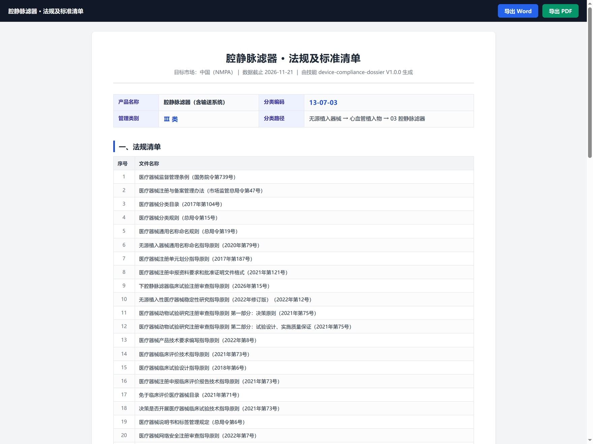
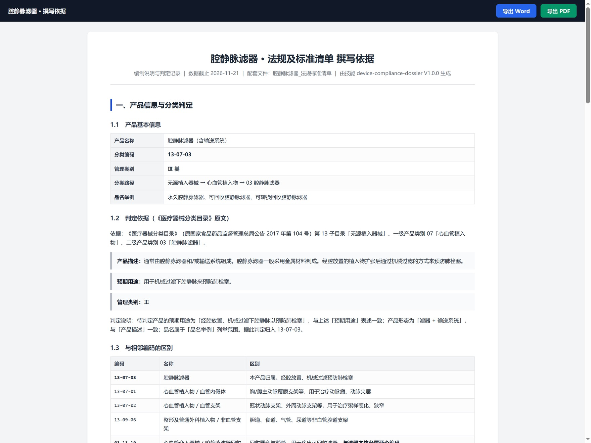

# 医疗器械产品法规标准清单生成器

*Medical device regulatory and standards checklist generator (AI agent skill). Input a device name, get the China NMPA registration input list — classification code, applicable regulations, GB/YY standards — as markdown and a printable HTML page.*

这是给 AI 助手用的**技能**（Skill），不是软件 —— 没有安装包、没有界面、不用敲命令。

装好之后，在对话框里说一句：

> 帮我输出「腔静脉滤器」的法规及标准清单

AI 就会按这套规则干活，产出**医疗器械注册申报**要用的两份东西：

- **法规及标准清单** —— 干净、正式、只有条目，申报时对照用
- **撰写依据** —— 判定过程、编写方法、责任划分，内部审核与应对检查时自证

这是 DHF（设计历史文档）里「**设计输入**」的一部分：先定"要满足什么法规、符合什么标准"，后面的验证、确认、检验、临床都围着这份清单往外长。**清单列错，后面全跑偏。**

## 长什么样

**法规及标准清单**（示例）

**撰写依据**（示例）

## 一次产出 4 个文件

| 文件 | 内容 |
|---|---|
| `<产品名>_法规标准清单_<日期>.md` | 清单正文 |
| `<产品名>_法规标准清单_<日期>.html` | 带导出按钮的页面 |
| `<产品名>_撰写依据_<日期>.md` | 判定过程 |
| `<产品名>_撰写依据_<日期>.html` | 带导出按钮的页面 |

## 怎么用（两步）

### 第一步：把技能装给 AI 助手

把 `device-compliance-dossier` 整个文件夹（或它的路径）交给你的 AI 助手，说：

> 装一下这个技能

也可以直接把文件夹拖进对话框。装一次就行，以后一直能用。

需要 AI 助手能运行代码、能联网。首次使用会让它装一个抓取组件（约两三分钟，装了以后不用再装）。

### 第二步：在对话框里说要什么

> 帮我输出「腔静脉滤器」的法规及标准清单

它会先给出**产品信息卡**（是什么 / 干什么用 / 几类 / 分类编码 / 相邻编码区别），**停下来等你确认**，确认后才往下做。这一步不能跳 —— 编码判错，整份清单作废。

### 你不用懂的，它替你想好了

分类目录去哪查、标准状态怎么核、哪条法规属于申报的哪一章 —— 这些规则都写在技能里，不用你操心。你要做的是三件事：**说清产品、确认编码、拿走文件**。

## 它真正解决的四件事

### 1. 判编码看「预期用途」，不看产品名称

同一个产品名可能对应完全不同的编码。典型例子「中心静脉导管」：

| 预期用途 | 编码 | 归属 |
|---|---|---|
| 输入药液、采血、测压 | 13-03 | 心血管介入器械 |
| 建立血透用短期中心静脉通路 | **10-04-03** | 血液净化辅助器具 |

两者的标准族与法规路径完全不同。命中的编码不止一个时，会把候选全列出来让你选，不自己挑一个往下走。

### 2. 指导原则逐字核「适用范围」

名字像不等于适用。例如《中心静脉导管注册审查指导原则》里明写"不包括与导管配合用的其他附件，如导丝、穿刺针、注射器、敷料等"—— 所以**套件类产品不适用**。

适用范围不符时不会自己判掉，会把「指导原则名称 + 它写的适用范围 + 与本产品的差异」摆出来，由你决定要不要作为"可参考"列入。

### 3. 标准状态四种都区分

| 状态 | 例 | 清单怎么写 |
|---|---|---|
| 现行 | GB/T 16886.1-2022 | 正常列 |
| 现行，但推荐新版 | YY/T 0316-2016 → 推荐 GB/T 42062-2022 | 只列新的那个 |
| 已废止，有替代 | YY/T 0681.12-2014 → 2022 版 | 列新版 |
| 已发布未实施 | GB 18280.1-2025（2029 才实施） | 列现行版，依据里说明 |

平台显示"现行"不等于能用 —— 要看官方过渡说明。核不到状态的标「未核实」，不猜。

### 4. 清单干净，判定过程分离

清单只列条目，不加解释列。判定过程、排除理由、责任划分都写进「撰写依据」。

## 导出 Word / PDF

生成的 html 顶部有「导出 Word」「导出 PDF」两个按钮，点一下就能带走。

**注意**：技能本身只产出 md 和 html，**不生成 .docx**。这个选择是有意的 —— 后端渲染 docx 要依赖跑的人机器上的模板、字体、办公软件版本，任一不同版式就飘。交给浏览器前端转换，任何机器导出来都一样。

## 和「医械法规库」技能配合（可选）

如果装过 [china-medical-device-regs](https://github.com/Alynxiao/china-medical-device-regs)，可以直接复用它的法规索引，省掉一部分查询时间。**没装也能正常跑**，只是第一次慢一点。

## 第一次会慢

包里不带缓存。第一次做某个产品要全量查（取分类目录、查法规、核 30 到 40 条标准），**十几分钟到半小时**属正常。查完会存到 `data/` 下，之后做同类产品命中率 80% 到 94%。

## 配合使用

注册申报的设计输入，三件事：查法规、查标准、合成清单。

| 技能 | 管什么 |
|---|---|
| [医疗器械法规库](https://github.com/Alynxiao/china-medical-device-regs) | 查有哪些**法规**适用 —— 条例、规章、指导原则 |
| [医疗器械标准库](https://github.com/Alynxiao/medical-device-standards) | 查有哪些**标准**适用 —— 国标 GB、行标 YY 的目录和征求意见稿 |
| **医疗器械产品法规标准清单生成器（本仓库）** | 把查到的**合成一张清单** —— 分类编码、适用法规、GB/YY 标准，直接进 DHF |

前两个负责查，清单生成器负责出结果。

## 说明

产出物是**辅助工具生成的工作底稿**，用于整理法规与标准依据，**不构成合规结论或法律意见**。法规的适用与解释以监管部门意见为准；标准状态以标准发布机构的最新公告为最终依据。交付前请自行核对关键条目。

本项目为个人整理，**与药品监督管理部门无隶属、委托或授权关系**。

代码以 MIT 许可发布（见 [`LICENSE`](LICENSE)）。

---

  

